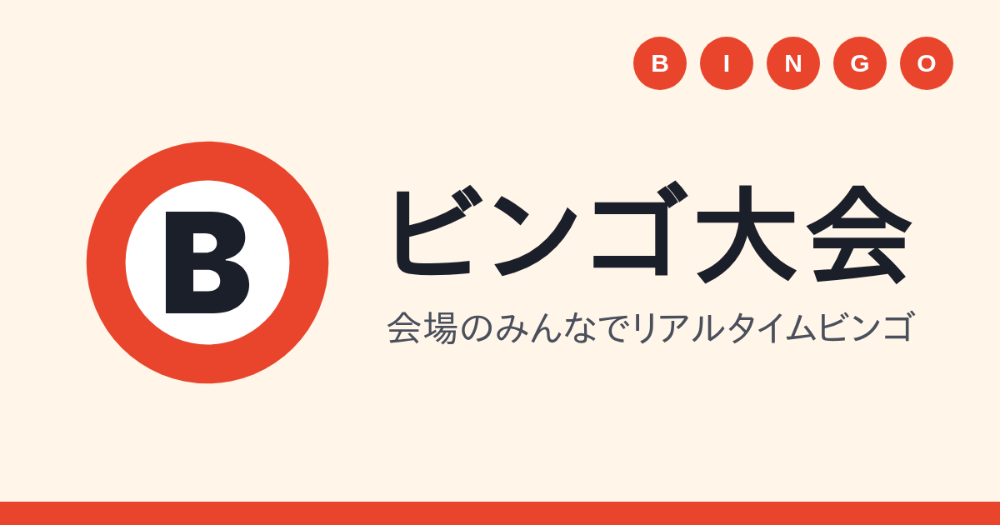

# ビンゴ大会



会場イベント（〜100人）向けの **リアルタイムビンゴ大会アプリ** です。
参加者は自分のスマホでカードを開き、司会が番号を引くと、全員のカードとスクリーンに同時に反映され、自動でマークが付きます。
紙のカードの配布・回収、番号の聞き逃し、手作業でのビンゴ確認をなくします。

Cloudflare Workers 上で、Next.js（OpenNext）と Cloudflare Agents SDK（Durable Objects）を使って動かしています。

## 特長

- **当日止まらない** — 通信が切れても自動で再接続し、同じカードに戻ります。リーチ・ビンゴの判定はサーバーで続けるので、つながっていない間にビンゴしても当選できます
- **迷わず参加できる** — 受付で配る紙の QR を読み、ニックネームを入れるだけ。ログインは不要です
- **すぐ届く** — 番号を引いてから約1秒で、全員の画面と投影画面に反映されます（110接続の負荷試験で確認）
- **盛り上がる** — 投影画面でドラムロールの演出と効果音、ビンゴが出たときは特別な演出。参加者の画面も演出が終わってから結果を出すので、ネタバレしません
- **公平** — 参加コードは1人1枚・1回だけ。重複参加を防ぎ、端末を変えたときは同じコードで元のカードに戻れます

## 画面

| 画面 | URL | 使う人 | できること |
|---|---|---|---|
| 管理 | `/` | 主催者 | 合言葉で入り、ルームの作成・一覧・削除、司会用 URL の表示・作り直し |
| 司会 | `/host/[roomId]` | 司会（複数人で共有可） | 開始・抽選・終了、参加者一覧（接続状態・リーチ・ビンゴ）、参加コードの発行・差し替え、結果の CSV 書き出し |
| 印刷 | `/host/[roomId]/print` | 受付 | 参加コード（QR 付き）を A4 に 3×4 で印刷 |
| 参加者 | `/room/[roomId]` | 参加者 | 5×5 のカード、自動マーク、リーチ・ビンゴの表示 |
| 投影 | `/screen/[roomId]` | 会場のスクリーン | 今引いた番号・これまでの番号・リーチの人数・ビンゴした人（表示だけ） |

## 当日の流れ

1. **事前準備**：管理画面でルームを作り、参加コードを発行して印刷する
2. **会場の準備**：投影用 PC で投影画面を開き、司会は手元の端末で司会画面を開く
3. **受付**：参加コードを1人1枚配る。参加者は QR を読んでニックネームを入れる
4. **抽選**：司会が「抽選」を押すたびに、スクリーンで演出が流れ、全員のカードにマークが付く
5. **ビンゴ**：投影画面にニックネームと順位が出るので、司会が読み上げて呼ぶ
6. **終了**：司会が「終了」を押すと、全画面に最終結果が出る。結果は CSV で書き出せる

ルールは 75 ボール方式（B1-15 / I16-30 / N31-45・中央 FREE / G46-60 / O61-75）です。終了したルームは7日後に自動で削除されます。

## 技術構成

- **Next.js (App Router)** ＋ **`@opennextjs/cloudflare`** で Workers にデプロイ
- **Cloudflare Agents SDK** の `Agent`（Durable Object）でルームの状態を管理し、WebSocket で同期
  - `BingoRoom` — 1ルーム＝1インスタンス。抽選・判定・参加者・参加コードを持つ
  - `RoomDirectory` — ルームの一覧（合言葉で守る）
- 1つの Worker に Next.js と Agent を同居（カスタムエントリ `worker.ts`）
- **Tailwind CSS v4** ＋ **shadcn/ui**
- **TypeScript** / **Vitest**（workerd 上で実行）/ **Playwright**（E2E）
- パッケージ管理は **pnpm**

### セキュリティの考え方

- 司会トークン・参加コード・参加者のカードは、全員に配られる公開 state に入れず、Durable Object の SQLite に保存します
- 司会の操作は、司会トークンで名乗った接続からの要求かをサーバーで確かめます
- 秘密の値は WebSocket の URL に入れず、接続後に送ります。ページ URL の `?t=` `?c=` は読み取ったらすぐ消します
- 保存する個人に関わる情報はニックネームだけです

詳しくは [docs/design/security.md](docs/design/security.md) を参照してください。

## 動かし方

Node.js 22 と pnpm 10 が必要です。

```sh
pnpm install

# ローカルの秘密の値（コミットしない）
cp .dev.vars.example .dev.vars   # ADMIN_PASSPHRASE に管理画面の合言葉を入れる

pnpm preview    # ビルドして、画面＋Agent を http://localhost:8787 で動かす
```

`pnpm dev` は Next.js だけを動かします（画面の見た目の確認用。Agent にはつながりません）。

### テスト

```sh
pnpm test        # Vitest（ゲームロジックの単体テストと、Agent の結合テスト）
pnpm test:e2e    # Playwright（司会・参加者・投影を別のブラウザで動かす）
pnpm load-test   # 負荷試験（110接続・抽選75回）
pnpm typecheck
pnpm lint
```

### デプロイ

```sh
pnpm wrangler login
pnpm wrangler secret put ADMIN_PASSPHRASE    # 管理画面の合言葉（12文字以上を推奨）

cp .env.example .env.production.local         # SITE_URL に本番の URL を入れる（OG 画像の URL に使う）

pnpm run deploy
```

`pnpm deploy` と書くと pnpm 自身のコマンドが動くので、必ず `run` を付けてください。

## ディレクトリ

```
worker.ts               Worker のエントリ（/agents/* は Agent へ、それ以外は Next.js へ）
wrangler.jsonc          Worker の設定（Durable Object のバインディング・マイグレーション）
src/agents/             BingoRoom・RoomDirectory
src/lib/                純粋関数（ゲームロジック・参加コード・入力チェック・CSV など）
src/app/                画面（管理・司会・印刷・参加者・投影）
src/components/         画面どうしで使い回す部品
src/hooks/              BingoRoom への接続
test/                   Vitest
e2e/                    Playwright
load/                   負荷試験
docs/                   仕様書・設計判断の記録（ADR）・テスト計画
```

## ドキュメント

仕様は [docs/spec.md](docs/spec.md)（目次）からたどれます。

- [企画概要](docs/product/overview.md) / [当日の進行シナリオ](docs/product/event-flow.md) / [ゲームルール](docs/product/game-rules.md)
- [機能要件](docs/product/requirements.md) / [非機能要件](docs/product/non-functional.md)
- [画面設計](docs/design/screens.md) / [ドメインモデル](docs/design/domain-model.md) / [リアルタイム通信仕様](docs/design/api.md) / [セキュリティ設計](docs/design/security.md)
- [設計判断の記録（ADR）](docs/adr/README.md) / [テスト計画](docs/test-plan.md)
