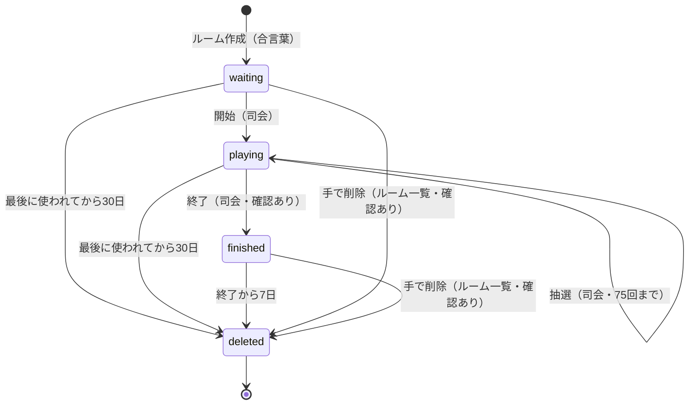
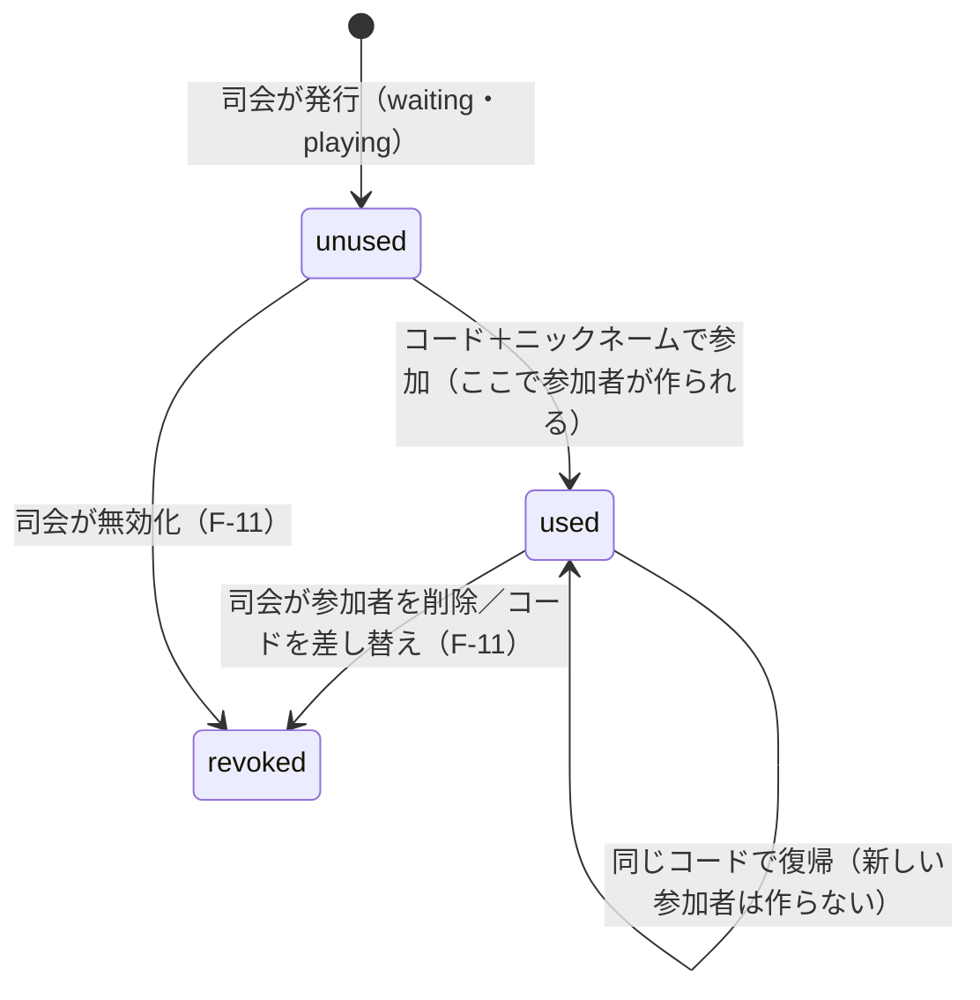
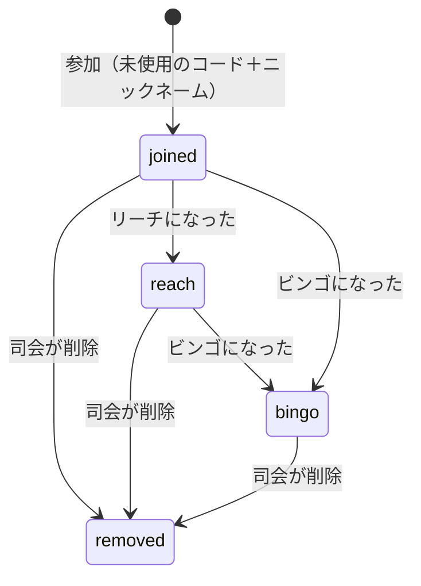

# ドメインモデルと状態遷移

> 状態: 確定（2026-10-31 に改訂。下の「変更履歴」を参照）

## 目的
データ構造とルームのライフサイクルを定める。実装（`src/agents/`）はこの文書に従う。用語は glossary.md と合わせる。

## 決定済み
- 1ルーム = 1 Agent インスタンス（名前 = roomId）
- ルームの状態: waiting / playing / finished（リセットはしない。finished から戻らない）
- finished になってから7日後に、ルームのデータをすべて削除する（Agent のスケジュール機能で予約する想定）
- 1ルーム＝1ゲーム（2回戦以上は持たない）
- **参加人数の上限：1ルームあたり参加者100人**（司会・投影画面を含めると最大で約110接続になる → #5 の保証する接続数を110に引き上げる）
- **終了しないまま放置されたルーム：最後に使われてから30日で削除する**（使うたびに期限が延びる）
- **ルームの一覧：合言葉を入れると、ルームの一覧と司会用 URL を確認できる**（司会用 URL をなくしても復旧できる）
- 参加者の接続状態（オンライン/オフライン）と最終接続時刻を記録する（F-07 で使う）
- ルーム一覧は S-01（`/`）に置く。合言葉を入れると、一覧と「新しいルームを作る」が並んだ管理画面になる
- **ルーム一覧から、ルームを手で削除できる**（確認あり）。ゲーム中（playing）のルームは削除できない

## 本文

### 1. 全体の構成
```
┌──────────────────────┐        ┌──────────────────────────┐
│ RoomDirectory（1つだけ） │ 1 ── * │ BingoRoom（ルームごとに1つ）   │
│  ルームの一覧            │        │  ゲームの状態・参加者・カード   │
└──────────────────────┘        └──────────────────────────┘
```
- **BingoRoom**：ルームごとの Agent（Durable Object）。ゲームに関するデータはすべてここにある
- **RoomDirectory**：ルームの一覧だけを持つ Agent。インスタンスは1つ（名前は固定）。合言葉で守る
  - 一覧のために別のデータベース（D1 など）は使わず、Agent（Durable Object）だけで作る（構成を増やさないため）

### 2. データの項目

保存場所の意味：**公開** ＝ 接続しているクライアントに配る／**司会** ＝ 司会だけに配る／**本人** ＝ その参加者だけに配る／**非公開** ＝ サーバーの中だけ（必要なときに権限を確かめて返す）。配り方の詳細は #8。

#### Room（ルーム）— BingoRoom
| 項目 | 内容 | 保存場所 |
|---|---|---|
| roomId | ルームの ID。推測されにくいランダムな文字列（URL に使う） | 公開 |
| name | ルーム名（例：忘年会2026） | 公開 |
| status | waiting／playing／finished | 公開 |
| hostToken | 司会トークン。ルーム一覧で司会用 URL を再表示するため、元の値で保存する | 非公開 |
| createdAt | 作成した日時 | 非公開 |
| startedAt／finishedAt | 開始・終了した日時 | 公開 |
| lastActiveAt | 最後に使われた日時（放置ルームの削除に使う） | 非公開 |
| deleteAt | 削除する予定の日時（終了後は公開。それまでは非公開） | 公開（終了後） |

#### Draw（抽選）— BingoRoom
| 項目 | 内容 | 保存場所 |
|---|---|---|
| seq | 何回目の抽選か（1〜75） | 公開 |
| number | 引いた番号（1〜75） | 公開 |
| drawnAt | 引いた日時 | 公開 |

#### Participant（参加者）— BingoRoom
| 項目 | 内容 | 保存場所 |
|---|---|---|
| participantId | 参加者の ID（ランダム。画面には出さない） | 非公開 |
| nickname | ニックネーム（ルーム内で重ならない） | ビンゴした人は公開。全員分は司会 |
| code | 使った参加コード | 本人・司会（F-09） |
| joinedAt／joinedAtSeq | 参加した日時と、その時点の抽選回数 | 司会 |
| online | 今つながっているか | 司会 |
| lastSeenAt | 最後につながっていた日時 | 司会 |
| reachLines | リーチのライン数 | 本人・司会（投影画面は人数だけ） |
| bingoAtSeq | 何回目の抽選でビンゴしたか（まだなら空） | ビンゴした人は公開 |
| bingoRank | ビンゴの順位（同着あり） | ビンゴした人は公開 |
| completedLines | 揃ったライン数（2本目以降の表示に使う） | 本人 |
| removed | 司会が削除したか（削除された人はどの画面にも出さない） | 非公開 |

#### Card（カード）— BingoRoom
| 項目 | 内容 | 保存場所 |
|---|---|---|
| participantId | どの参加者のカードか（1人1枚） | 非公開 |
| cells | 5×5 の番号（中央は FREE） | 本人 |

- マーク済みかどうかは保存しない。引かれた番号（Draw）から毎回計算する（データが食い違わないようにするため）

#### JoinCode（参加コード）— BingoRoom
| 項目 | 内容 | 保存場所 |
|---|---|---|
| code | 参加コード（6文字。形式は #9 の 2-1） | 非公開（印刷ページ・F-09 で司会に返す） |
| status | unused（未使用）／used（使用済み）／revoked（無効） | 司会 |
| participantId | 使った参加者（使用済みのとき） | 非公開 |
| issuedAt | 発行した日時 | 司会 |

- 参加者を削除すると、その人のコードは revoked になり、そのコードでは参加も復帰もできない
- 1ルームで発行できるコードは最大150枚（参加者100人＋予備）。参加できるのは、発行枚数に関係なく100人まで

#### RoomEntry（ルーム一覧の1行）— RoomDirectory
| 項目 | 内容 |
|---|---|
| roomId | ルームの ID |
| name | ルーム名 |
| status | waiting／playing／finished（BingoRoom が変わるたびに知らせる） |
| hostToken | 司会用 URL を再表示するために保存する（作り直したときは、BingoRoom と両方を更新する） |
| createdAt／deleteAt | 作成日時と削除予定日時 |

### 3. 参加者の端末に保存するもの
- ブラウザ（localStorage）には **参加コード** をルームごとに保存する
  - 開き直したときは、保存したコードで自動的に復帰する（F-21）。コードを入れ直したときと同じ仕組みになる
  - 参加者 ID は端末に渡さない

### 4. ルームの状態遷移

| 状態 | できること |
|---|---|
| waiting（開始前） | 参加・復帰、コードの発行・印刷・差し替え・無効化、参加者の削除、CSV、開始 |
| playing（ゲーム中） | 抽選、途中参加・復帰、コードの発行・印刷・差し替え・無効化、参加者の削除、CSV、終了 |
| finished（終了） | 結果を見る、復帰、CSV（新しい参加・抽選・コードの発行はできない） |
| deleted（削除済み） | 何もできない。URL を開くと「終了し、削除されました」または「見つかりません」 |

- finished から waiting や playing に戻ることはない
- 削除するときは、BingoRoom のデータをすべて消し、RoomDirectory の一覧からも消す

### 5. 参加コードの状態遷移
参加コードは、参加者より先に作られる。**コードを発行しただけでは参加者は存在しない。**

#### 5-1. 発行のタイミング
| タイミング | 誰が | 内容 |
|---|---|---|
| 事前準備（waiting） | 司会 | 参加予定人数＋予備を発行して印刷する（#2） |
| 受付中・ゲーム中（waiting・playing） | 司会 | 足りなくなったら追加で発行する（F-02） |
| 終了後（finished） | — | 発行できない |

- 1ルームで発行できるのは150枚まで

#### 5-2. 状態遷移

| 状態 | 意味 | このコードでできること |
|---|---|---|
| unused（未使用） | 発行済みで、まだ誰も使っていない | 新しく参加する（参加者が作られる） |
| used（使用済み） | 参加者と紐づいている | 紐づいた参加者のカードに復帰する |
| revoked（無効） | 削除・無効化された | 何もできない（参加も復帰もできない） |

- コードを差し替えると、新しいコードは最初から used（同じ参加者に紐づく）。古いコードは revoked になる。このため、1人の参加者に紐づく有効なコードは常に1つ

#### 5-3. 参加コードと参加者の関係
```
司会がコードを発行
   │
   ▼
JoinCode: unused        ← この時点では参加者はいない
   │  参加者がコード＋ニックネームを入れて「参加」
   ▼
JoinCode: used  ──── 1対1 ────▶  Participant: joined（カードも作られる）
   │                                  │
   │ 同じコードで復帰 → 同じ参加者に戻る  │
   │                                  │ 司会が削除
   ▼                                  ▼
JoinCode: revoked  ◀──────────────  Participant: removed
```

### 6. 参加者の状態遷移
参加者は、未使用の参加コードで参加したときに作られる。コードを発行しただけでは参加者は存在しない（コードの状態は 5 を参照）。


- 接続状態（online/offline）は、この状態とは別に持つ。どの状態でもオフラインになりうる
- マークは減らないので、リーチやビンゴから前の状態に戻ることはない

### 7. 期限と自動削除
| きっかけ | 削除する日時 | 実装 |
|---|---|---|
| 終了した | 終了から7日後 | 終了したときに、Agent のスケジュール機能で削除を予約する |
| 手で削除した | すぐ（ゲーム中は削除できない） | ルーム一覧から削除すると、BingoRoom のデータと一覧の行を消す。接続中の画面には「削除されました」と出す |
| 放置された | 最後に使われてから30日後 | 司会の操作・参加・接続があるたびに lastActiveAt を更新し、削除の予約を30日後に入れ直す |

- 「使われた」とみなすのは、司会の操作、参加・復帰、参加者や投影画面の接続

### 8. 上限
| 項目 | 上限 |
|---|---|
| 1ルームの参加者 | 100人（達したら「定員に達しました」と表示） |
| 1ルームで発行できる参加コード | 150枚 |
| 抽選 | 75回 |
| ニックネームの長さ | 1〜20文字（前後の空白は除く） |
| ルーム名の長さ | 1〜40文字 |
| 同時に開けるルームの数 | 制限しない（合言葉を知っている人だけが作れる） |

## 未決事項
（なし）

## 変更履歴
- 2026-10-31 初版を確定
- 2026-10-31 #9 の決定を反映：コードの差し替え・無効化を状態遷移に追加
- 2026-10-31 文書間の矛盾を修正：deleteAt の公開範囲を #8 に合わせた。状態ごとにできることに、コードの差し替え・無効化と CSV を追加。参加者の状態遷移図から、起こらない遷移の矢印を削除。司会トークンの作り直しで両方を更新することを明記
